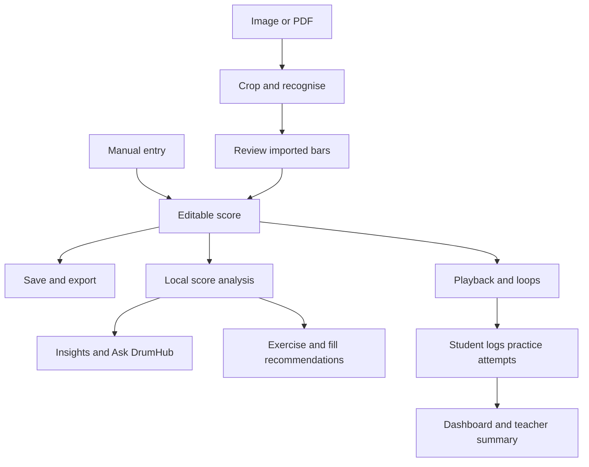

# Project overview

[Back to guide index](README.md)

## What DrumHub does

DrumHub combines a drum notation editor with recognition and practice tools. A student can type a groove from scratch, import a cropped chart, or process a complete page. The result is an editable score rather than an image placed on screen. That makes it possible to correct a misread drum, change note lengths, play a passage slowly, and ask questions about the notes.

The current interactive workflow is built around 4/4. Other valid meters can be stored and opened, but their scores are view-only; editing, playback, and analysis currently support 4/4. The supported kit contains 14 drum and cymbal names shared by the editor and local model.

## Main application areas

The top bar contains the title, saved score tempo, and screenshot-paste action. The notation area displays the score and editing cursor. A floating drum keypad supports mouse entry and mirrors number-key shortcuts. The side menu exposes local bar import, page/PDF import, and bars-per-line layout.

The import area reports progress, conversion problems, and which imported bars still need checking. The playback transport provides Play/Stop, practice tempo, looping, count-in, and metronome controls. The side panel has four tabs: Insights, Ask DrumHub, Library, and Practice. Library contains both Exercises and Fill Lab. Native desktop menus provide file operations, undo/redo, and exports.

## How the parts connect

Practice attempts are logged by the user. Playback does not listen to the drummer or automatically grade their performance.

## Technical structure

| Area | Responsibility |
| --- | --- |
| `index.html`, `styles.css`, `app.js` | Application screen, styling, and initialization. |
| `js/` | Score rules, rendering, user interfaces, playback, local analysis, and export conversion. |
| `main.js`, `preload.js`, `desktop/` | Desktop dialogs, files, clipboard, service management, cloud calls, and SQLite. |
| `backend/` | Local Python service for bar recognition and page segmentation. |
| `ml/data-prep/`, `ml/omr/` | Dataset creation, model training, evaluation, export, and release. |
| `test/`, `eval/` | Behavior checks and measured comparisons. |
| `plan/`, `docs/` | Plans, project explanations, and repository guidance. |

The renderer runs native JavaScript modules and uses VexFlow 5 for SVG notation. Electron's main process owns privileged operations. A narrow preload API lets the renderer request specific operations without receiving direct filesystem or Node access. Recognition uses a separate local Python process and an ONNX model.

## Local and cloud operation

Manual editing, score files, playback, Insights, suggested assistant questions, catalogue recommendations, and practice storage are local. Local recognition needs Python, its runtime dependencies, and a valid model bundle. Cloud recognition and explanations additionally need internet access, an API key, and the app's cloud-help setting enabled through its adult confirmation.

The app's current configured defaults use separate models for recognition and conversation. Those names are implementation settings, not a promise about provider availability. Cloud failures have feature-specific handling: Ask DrumHub and teacher summaries can return local responses; screenshot import reports a failure; Fill Lab can still recommend existing local fills.

## Example workflow

Import a page, adjust its bar boxes, and add its transcriptions. Check the imported bars and save the score. Use Insights to locate busy notation, select a passage, and play it slowly in a loop. Open a related exercise in Library. Record practice attempts for the selected student and generate a progress summary from their saved history.

## Source map

Start with [app.js](../../app.js) for connected UI modules, [index.html](../../index.html) for the screen, [main.js](../../main.js) for desktop wiring, and [preload.js](../../preload.js) for the allowed renderer APIs.
