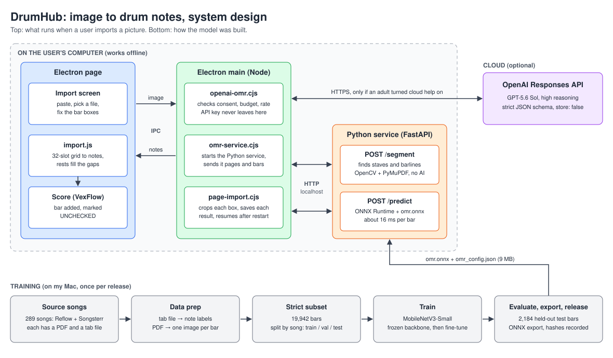

# DrumHub — How a picture becomes drum notes

Speaking notes for the interview. About 4 minutes if you say every section, 90 seconds if you
only say the lines in **bold**.

All numbers come from saved evaluation reports in this repository (`ml/releases/baseline-14drum-v1/`
and `eval/recognition/`, dated 2026-09-12 to 2026-09-15).

---

## 1. Open with the problem (20 seconds)

> **"Drum students get their music as PDFs, photos and screenshots. To edit it or play it back,
> a teacher has to retype every bar by hand. I built a pipeline that reads the picture and turns
> it into an editable score."**

---

## 2. The pipeline in one picture (30 seconds)

```
image or PDF page
   │  Step 1  find the bars          classic computer vision, no AI
   ▼
one bar image
   │  Step 2  read the bar           my trained model (offline)  or  a cloud model
   ▼
[ {duration: "eighth", drums: ["kick", "hi_hat_closed"]}, ... ]
   │  Step 3  build an editable bar  plain code
   ▼
bar in the score, marked UNCHECKED until a person confirms it
```

> **"Three steps: find the bars, read each bar, turn the result into something you can edit.
> Only the middle step is machine learning."**

### System design



How to walk through it:

- The **page** only draws and edits. It sends the image to the main process and gets notes back.
- The **main process** owns everything risky: files, the API key, the consent and budget checks.
- The **Python service** runs on the same computer. One endpoint finds the bars, the other
  reads a bar with my model.
- The **cloud** is the only part that needs the internet, and only if an adult turned it on.
- The **training row** runs on my Mac, not in the app. Its only output is the 9 MB model file
  that the Python service loads.

---

## 3. Step 1 — Finding the bars (40 seconds)

What to say:

- This step uses OpenCV, not a model. The rules are simple enough to write by hand.
- Five evenly spaced horizontal lines make a staff.
- A barline is a vertical stroke that covers the staff and **stops at its edges**. Drum stems
  also cross the staff, but they keep going past it. That is how I tell them apart.
- The user sees the boxes and can move, resize, add or remove them before anything is read.

| Source | Pages exactly right | Bars wrong |
|---|---|---|
| Songsterr | 528 of 549 (96%) | 33 of 16,915 (0.2%) |
| Reflow | 215 of 308 (70%) | 264 of 7,019 (3.8%) |

Code: `backend/page_segment.py`

---

## 4. Step 2 — Reading one bar (60 seconds)

> **"I treat a bar as a grid of 32 time slots. For each slot the model answers two questions:
> which drums are hit, and how long is the note."**

| Part | Detail |
|---|---|
| Input | One bar image, grayscale, resized to 128×384 |
| Backbone | MobileNetV3-Small, pretrained on ImageNet |
| Drum head | 32 slots × 14 drums, each a yes/no (several drums can hit at once) |
| Duration head | 32 slots × 10 note lengths, pick one |
| Size | About 2.3 million parameters, a 9 MB file |
| Speed | About 16 ms per bar on an M1 Mac, offline |

Why these choices:

- **Small model:** it has to run on a student's laptop with no internet and no cost.
- **Yes/no per drum instead of one answer per slot:** a kick and a hi-hat often land together.
- **ONNX export:** the app only needs ONNX Runtime, not PyTorch.

It runs inside a small local Python service (FastAPI, `/predict`) that the Electron app starts
and stops.

Code: `ml/omr/omr_model.py`, `backend/app.py`, `desktop/omr-service.cjs`

---

## 5. Where the training data came from (40 seconds)

> **"I didn't label anything by hand. Every song exists as both a PDF and a tab file, so the PDF
> gives me the picture and the tab file gives me the answer."**

- 289 songs: my own Reflow teaching charts plus Songsterr tabs.
- 23,660 bar image and label pairs, filtered to a strict 19,942 the model can represent.
- Split: 15,839 train, 1,919 validation, 2,184 test.
- **Split by song, not by bar.** Drum bars repeat a lot inside one song, so a random split would
  put near-identical bars on both sides and make the scores look better than they are.
- Trained in two phases: 15 epochs with the backbone frozen, then 25 epochs fine-tuning the whole
  model at a tenth of the learning rate.

---

## 6. Step 3 — Building the editable bar (20 seconds)

- Notes are placed on the 32-slot grid, gaps are filled with rests, triplets are grouped, and
  the bar is always padded to a full 4/4.
- Anything the editor cannot show becomes a plain-language warning instead of a silent guess.
- The bar is added with an amber dashed box and counted as "to check".

Code: `js/import.js`

---

## 7. The honest numbers (40 seconds)

Measured on 2,184 bars from 28 songs the model never saw.

| Metric | Value |
|---|---|
| Kick F1 | 0.94 |
| Snare F1 | 0.88 |
| Closed hi-hat F1 | 0.87 |
| Crash F1 | 0.70 |
| Toms F1 | 0.21 to 0.39 |
| Note length correct (at real hits) | 89.7% |
| Whole bar exactly right | 12.5% |

> **"It is strong on kick, snare and hi-hat, which is most of a beginner chart, and weak on rare
> drums. Only one bar in eight is perfect, because one wrong hit fails the whole bar. That is
> exactly why every imported bar starts as unchecked."**

What is going wrong, and what I would do next:

| Problem | Cause | Next step |
|---|---|---|
| Toms and ride claimed in bars that have none | Rare drums were up-weighted in training | Lower that weighting, or tune a threshold per drum |
| Toms confused with each other | They differ only by height on the staff, and average pooling blurs position | Use pooling that keeps vertical position |
| 0% exact on bars drawn by DrumHub itself | Only trained on Reflow and Songsterr styling | Train on more notation styles |
| Train loss 0.18 against validation 0.40 | Overfitting on 289 songs | More songs (target 500+) |

---

## 8. The cloud option and the comparison (30 seconds)

Pasting a screenshot sends it to an OpenAI model at high reasoning effort with a strict JSON
schema, then runs the same checks and conversion. It is off by default and an adult has to turn
it on. The app's default for this is GPT-5.6 Sol, up to 64 bars per screenshot. The benchmark
numbers below were measured with GPT-5.6 Luna.

| Recogniser | Test set | Bars exactly right | Time per bar | Cost |
|---|---|---|---|---|
| My local model | Songsterr held-out (1,548) | 16.8% | 15 ms | free |
| My local model | DrumHub-rendered (45) | 0% | 30 ms | free |
| Luna, high reasoning | DrumHub-rendered (45) | 51.1% | 89 s | US$0.43 for the set |
| Luna, high reasoning | Songsterr, first 30 | 3.3% | 144 s | US$0.32 for the set |
| My local model | Songsterr, first 30 | 10.0% | 15 ms | free |

> **"Neither one wins everywhere. The cloud model is better on clean DrumHub-style bars; my model
> is better on Songsterr charts, and it is instant, free and private. The benchmark tells me
> which to use for which source."**

---

## 9. Questions they will probably ask

**Why build your own model when a cloud model exists?**
Speed, cost and privacy. Mine reads a bar in 16 ms offline for free. The cloud model takes about
90 seconds per bar, costs money, and needs an adult's consent because the users are children.

**Why is 12.5% acceptable?**
It is a baseline, not the finished product, and I say so in the model card. The design assumes
the model is wrong sometimes: every imported bar is flagged until a person checks it. Fixing a
mostly right bar is still faster than typing it from nothing.

**Why MobileNetV3 and not a bigger vision model?**
It had to run on a laptop CPU. I planned a larger vision-language model first, then chose the
small one because a fixed 32-slot grid is a simple enough output that a classifier can do it.

**How do you know the numbers are real?**
The test songs are held out by song. Every release records the hashes of the model, the dataset
and the results, and the release script refuses to bundle if they do not match.

**What was the biggest mistake?**
My first benchmark of another cloud model scored 82%. The real number was 40%: it ran through
an agent that could open the answer file. Now every recogniser is tested with one image in an
empty folder.

**Why not shrink the model with int8 quantisation?**
I measured it. It was 3.7 times smaller but slower, and it changed the output on all 200 test
bars. So the app ships the full-precision version.

---

## 10. Closing line

> **"The main thing I learned is to measure before trusting. Every number I've given you comes
> from a saved report I can open and show you."**
